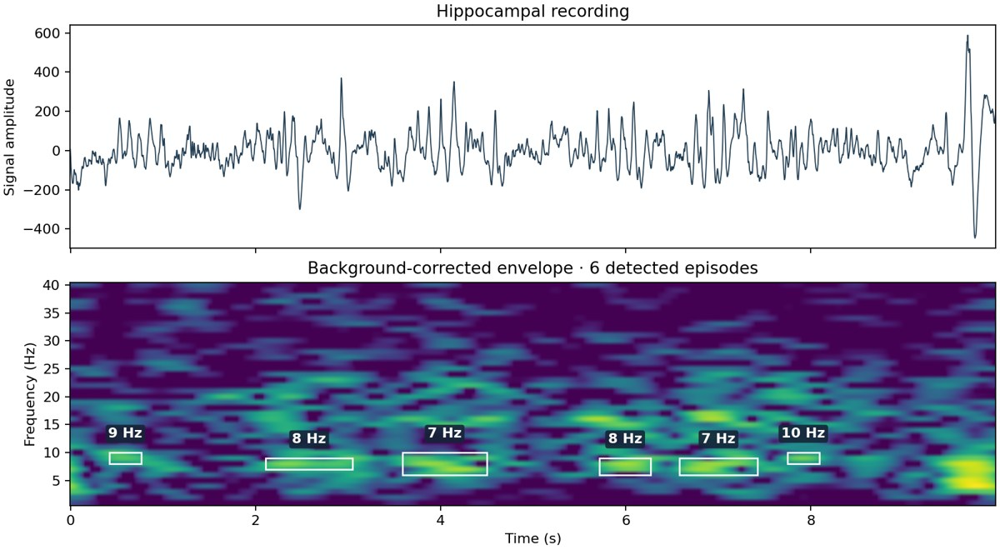

# Cyclic Homogeneous Oscillation detection (CHO)

CHO is a MATLAB method for detecting oscillatory episodes in neural recordings. The [eLife article](https://elifesciences.org/articles/91605) describes the method. The detector is implemented in [CHO_v22.m](functions/CHO_v22.m).



White boxes mark the six oscillatory episodes detected by the [Python demo](https://github.com/neurotechcenter/CHO/pull/4) in the hippocampal recording used for Figure 8. Each label gives the episode’s detected center frequency in Hz.

## Run the hippocampal example

Open the repository root in MATLAB and run:

```matlab
add_path
figure8BCDE
```

[figure8BCDE.m](figure8BCDE.m) loads the example hippocampal signal, sets the sampling rate to 500 Hz, and analyzes frequencies from 1 to 40 Hz. With plotting enabled, the detector displays the signal and detected episodes. Inspect `cho_output` in the workspace for the results.

The detector uses MATLAB toolbox functions including `autocorr` (Econometrics Toolbox), `hilbert` (Signal Processing Toolbox), and `bwlabel` (Image Processing Toolbox). For scripts that use FieldTrip or EEGLAB, add the corresponding installation directory to the MATLAB path before running setup.

## Simulation scripts

The simulation examples are [figure4BCD.m](figure4BCD.m) and [figure4EFG.m](figure4EFG.m).

## Citation

See the [eLife article](https://elifesciences.org/articles/91605) for the paper and citation. The [2023 bioRxiv preprint](https://doi.org/10.1101/2023.10.04.560843) is also available.

Related patent application: Hohyun Cho and Peter Brunner, US Patent Application No. 18/193,930, “Systems and Methods for Detection of Neurophysiological Signal Oscillations.”
