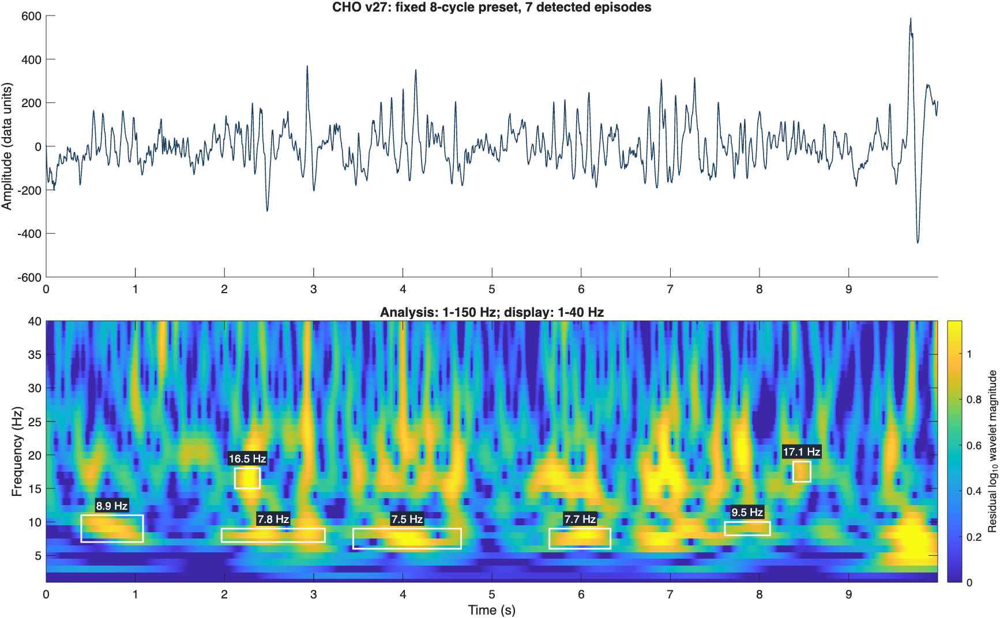

# Cyclic Homogeneous Oscillation detection (CHO)

CHO detects oscillatory episodes in neural recordings. **The current research implementation is the wavelet-based `CHO_v27`.** This snapshot includes the fixed 8-cycle configuration used in the UAB seizure research analyses, its dependencies, and a runnable public example. The earlier v22 implementation remains available for manuscript reproduction.

## Try the wavelet v27 example

Get the [v27 branch](https://github.com/neurotechcenter/CHO/tree/wavelet-v27). For a small checkout containing the code and example signal, without the larger manuscript datasets:

```sh
git clone --filter=blob:none --sparse --branch wavelet-v27 https://github.com/neurotechcenter/CHO.git CHO-v27
cd CHO-v27
git sparse-checkout set --no-cone '/*' '!/data/*' '/data/data_for_figure8.mat'
```

Open the repository root as the current folder in a fresh MATLAB session:

```matlab
add_path
cho_output = example_CHO_v27;
```

The example analyzes the included 10-second hippocampal recording at **500 Hz**, with a **1–150 Hz** analysis range. On MATLAB R2026a Update 3 it returns **7 oscillatory episodes**. The figure displays 1–40 Hz for readability; detection still uses the full 1–150 Hz range. The fixture is public manuscript data, not a UAB patient recording.



```matlab
cho_output.bounding_boxes
cho_output.param
save('cho_v27_output.mat', 'cho_output')
exportgraphics(gcf, 'cho_v27_example.png', 'Resolution', 150)
```

## Requirements

Tested with **MATLAB R2026a Update 3** on Apple silicon. The automated workflow uses R2026a on Ubuntu. Other releases have not been verified by these checks.

| Toolbox | Functions used |
| --- | --- |
| Econometrics Toolbox | `autocorr` |
| Signal Processing Toolbox | `tukeywin`; `hilbert` in v22 |
| Image Processing Toolbox | `bwlabel` |
| Optimization Toolbox | `optimoptions`, `lsqcurvefit` |
| Statistics and Machine Learning Toolbox | `ttest2` in the original v27 fitting helper; `corr` for correlation merging |

The custom Morlet-wavelet functions are included; MATLAB Wavelet Toolbox is not required. The public examples do not require FieldTrip or EEGLAB. Some historical scripts use those packages.

## Analyze your own single-channel signal

Supply a time-by-one signal vector and its actual acquisition sampling rate:

```matlab
add_path
param = cho_v27_parameters();
param.frequency_range = 1:150;  % adjust to the research question
param.plot = 1;
cho_output = CHO_v27(signal, sampling_rate_hz, param);
```

The research preset explicitly selects:

| Parameter | Value |
| --- | --- |
| `wavelet_cycles` | `8` |
| `minimum_cycles` | `3` |
| `osc_threshold_std` | `2` |
| `frequency_range` / `frequency_step` | `1:150` / `1` Hz |
| `merge_mode` | `'fast_tf_overlap'` |
| `fast_merge_time_overlap_frac` | `0.05` |
| `fast_merge_freq_gap_hz` | `1` |
| `ovlp_threshold` | `0.5`, retained in the research parameter structure |

Earlier UAB review analyses also used 1–100 Hz. The detector clips requested frequencies below Nyquist using a one-step guard; inspect `cho_output.freqs` for the actual frequency grid. Fast merging uses the explicit fast-merge fields above; `ovlp_threshold` is not its time-overlap control.

### Function defaults differ from the research preset

Calling `CHO_v27(signal, fs)` directly uses **1–40 Hz**, frequency-dependent wavelet cycles (`'linear_3_10'`), a **2-cycle minimum**, and **correlation merging**. `cho_v27_parameters()` explicitly selects the fixed 8-cycle, 3-cycle-minimum, fast-merging research configuration. These settings can produce different detections; choose and report them explicitly.

### Output

`cho_output` is a scalar structure:

| Field | Meaning |
| --- | --- |
| `status` | `"ok"` or an empty/invalid-input status |
| `bounding_boxes` | Episodes: `start`, `stop`, `center_tp`, `center_fp`, `minF`, `maxF`, `peak_val`, and ACF diagnostics |
| `n_final_boxes` | Final episode count |
| `freqs`, `param` | Actual frequency grid and effective settings |
| `ap_fit` | Selected aperiodic background fit |
| `n_initial_boxes`, `n_after_cycle_check_boxes`, `n_after_autocorr_check_boxes` | Intermediate counts |

Frequencies are in Hz. Time fields are **one-based sample indices**: convert onset to seconds with `(box.start - 1) / fs`. `peak_val` and the example color scale describe residual log10 wavelet magnitude after aperiodic subtraction. CHO detects episodes within a supplied signal window; seizure labels and onset annotations belong to the surrounding research analysis.

Empty or flat input returns no episodes with an input-status value. The existing detector interpolates missing values where possible; review signal quality and preprocessing for your analysis. Record the commit SHA, sampling rate, and `cho_output.param` with each result.

## Legacy manuscript example

```matlab
add_path
figure8BCDE
```

This runs the earlier **FFT/Hilbert v22** implementation at 500 Hz over 1–40 Hz and returns **6 episodes**. The original simulation entry points are `figure4BCD` and `figure4EFG`.

## Validation and provenance

```matlab
results = runtests('tests');
assertSuccess(results);
```

Tests cover the v27 preset and distinct function defaults, flat input, Nyquist clipping, warning-state preservation, figure export, and the legacy v22 example. GitHub Actions retains PNG/MAT/JUnit artifacts. See [v27 source provenance and validation](docs/CHO_V27.md) and [CONTRIBUTING.md](CONTRIBUTING.md).

The detector's numerical source is preserved from the UAB research version. Packaging isolates dependencies and restores warning settings after the legacy wavelet helper calls. These checks establish installation and output consistency, not sensitivity, specificity, or generalization to new recordings.

## Citation and patent information

Cho H, Adamek M, Willie JT, Brunner P (2024). *Novel cyclic homogeneous oscillation detection method for high accuracy and specific characterization of neural dynamics*. eLife 12:RP91605. [Version of Record DOI: 10.7554/eLife.91605.3](https://doi.org/10.7554/eLife.91605.3). See [CITATION.cff](CITATION.cff). The article describes the published method; v27 is a subsequent research implementation.

Related patent: Peter Brunner and Hohyun Cho, *Systems and methods for detection of neurophysiological signal oscillations*, [U.S. Patent 12,678,081 B2](https://patentsgazette.uspto.gov/week28/OG/html/1548-2/US12678081-20260714.html), issued July 14, 2026; application 18/193,930. The [2023 preprint](https://doi.org/10.1101/2023.10.04.560843) is also available.

## License and maintainer

[MIT License](LICENSE). Existing helper attribution is retained. Maintainer: Hohyun Cho. Please use [GitHub issues](https://github.com/neurotechcenter/CHO/issues) for reproducible bug reports.
